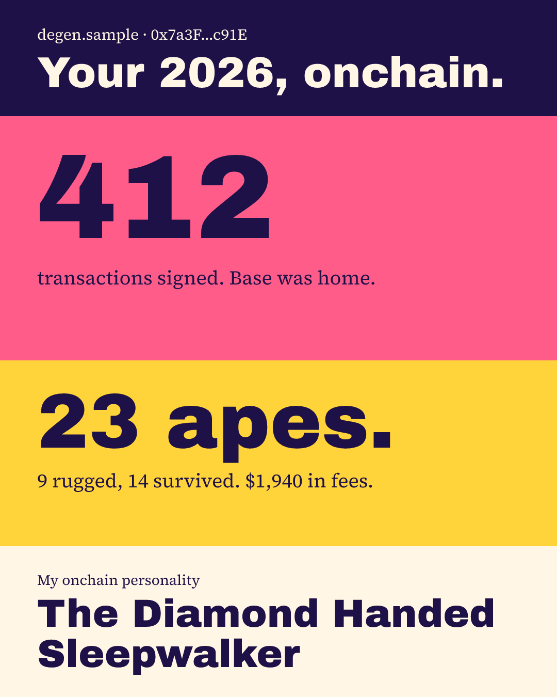
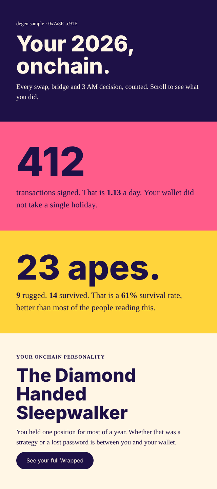
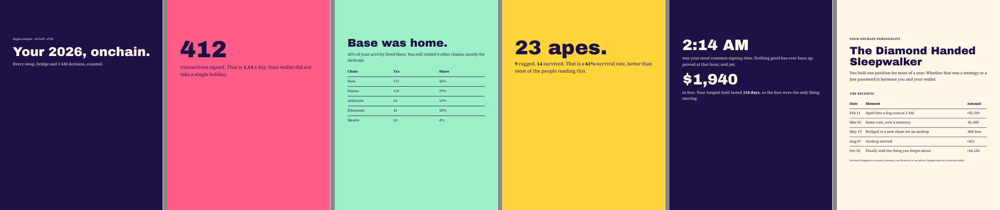

# Onchain Wrapped

A Spotify Wrapped style year in review for any wallet, built with **Hyper Elements** (`@unlayer/react-elements`).
One data object and one set of components render **three outputs**:

| Output | File | Use |
|---|---|---|
| Email (table based, Outlook/Gmail safe) | `email.html` | A teaser with the headline stats and a button to the full story |
| Web page (responsive div/flexbox) | `web.html` | The full scrolling story |
| PDF (print ready) | `onchain-wrapped.pdf` | A keepsake with a receipts page |
| Share card (PNG) | `out/share-card.png` | A 1080x1350 image of the stats, made for posting |





| Email | PDF |
|---|---|
|  |  |

## How Hyper Elements is used

- **One component tree, three roots.** `src/template.tsx` builds every section as a `<Row>` / `<Column>` color block. The only thing that changes between outputs is the root: `<Email>`, `<Page>`, or `<Document>`. The email variant renders fewer blocks, the document variant adds a `<PageBreak>` and a receipts `<Table>`.
- **Components used:** `Email`, `Page`, `Document`, `Row`, `Column`, `ColumnLayouts`, `Heading`, `Paragraph`, `Button`, `Table`, `Divider`, `PageBreak`.
- **Custom React components inside Elements.** `Block`, `Big` and `Say` are plain React components that return Elements, so the design system lives in code.
- **`renderToHtml`** produces the three HTML files. **`renderToJson`** writes `out/design.json`, which loads into the Unlayer visual editor so a non developer can tweak the same design.
- **PDF:** `Document` mode outputs print HTML, and `src/pdf.ts` prints it with Playwright.

## Run it

```bash
npm install
npm run build     # writes out/email.html, out/web.html, out/document.html, out/design.json
npx playwright install chromium   # first time only, for the PDF
npm run pdf       # writes out/onchain-wrapped.pdf
npm run card                       # writes out/share-card.png, a 1080x1350 share image
```

No API keys needed. All numbers are **sample data for a fictional wallet** in `src/data.ts`.

## Plug in a real wallet

Replace `sample` in `src/data.ts` with data from your indexer of choice (Alchemy, Helius, Covalent, Dune) that matches the `WalletYear` type. Everything else renders automatically, including the personality pick in `pickPersona`.

## Notes

- This is a novelty summary. It is not financial or tax advice.
- The display font is Arial Black with Impact as a fallback so the email stays client safe.

MIT licensed.
