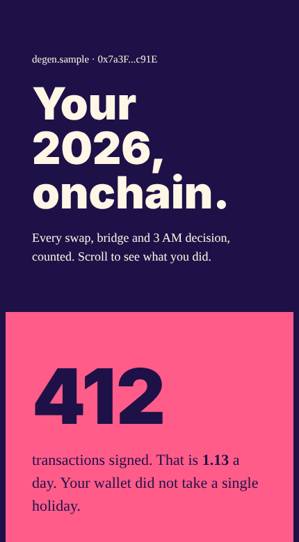

# Onchain Wrapped

A Spotify Wrapped style year in review for any wallet, built with **[`@hyper-elements/react`](https://github.com/hyper-elements/hyper-elements)**.
One data object and one set of components render **four outputs**:

| Output | Root | Rendered with | File |
|---|---|---|---|
| Teaser email | `Email` | `render()` | `out/email.html`, `out/email.txt` |
| Scrolling web story | `Page` | `render()` | `out/index.html` |
| Keepsake PDF (6 full-bleed pages) | `Document` | `renderPdf()` | `out/wrapped.pdf` |
| 1080 x 1350 share card | `Canvas` | `renderImage()` | `out/share-card.png` |




| Email | PDF |
|---|---|
|  |  |

## How Hyper Elements is used

- **One theme, four roots.** `defineTheme()` in `src/theme.ts` holds the palette (ink, flamingo, mint, sun, paper), the fonts, the button style and named styles. Every `Email`, `Page`, `Document` and `Canvas` takes the same `theme`, and designs read colors with `token("colors.flamingo")`.
- **One tree of story blocks.** `src/template.tsx` builds each block once. In an email or page a block is a `Section`. In the PDF the same block becomes a full-bleed `Document.Page` with its own `backgroundColor`. The email shows 4 blocks, the page 8, the PDF 6.
- **Phone styles where they exist.** Big numbers shrink on phones with `style.mobile`. The library rejects phone styles in a PDF, so the PDF gets none.
- **Real PDF and PNG.** `renderPdf()` (from `@hyper-elements/react/pdf`) and `renderImage()` (from `@hyper-elements/react/image`) write the PDF and the share card. No browser is needed.
- **Fitted text on the card.** The personality line uses `fit` on the `Canvas` so it picks the largest size that fits in two lines.
- **Tables** (`Table`, `TableRow`, `TableCell`) for the chain breakdown and the receipts page.
- **Validation as a guide.** The library's own errors and diagnostics shaped this build, for example it refused phone styles in the PDF and flagged `flex` outside a Row.

## Run it

```bash
npm install     # also copies the fonts from @fontsource into public/fonts
npm run build   # writes everything to out/
npm run check   # typecheck
```

Open `out/index.html` in a browser. Everything runs on **sample data for a fictional wallet** in `src/data.ts`. To use a real wallet, fill the `WalletYear` object from an indexer such as Alchemy, Helius or Dune.

## Notes

- Email clients cannot load web fonts, so the email uses Arial Black with a bold fallback instead of Archivo Black.
- The Wrapped format is a novelty summary, not financial or tax advice.
- Fonts: Archivo Black and Source Serif 4 (SIL Open Font License).

MIT licensed.
